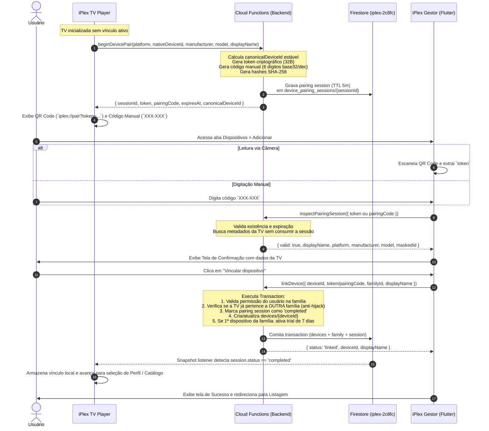

# iPlex — Fluxo Completo de Pareamento de Dispositivos (Pairing Flow)

## 1. Visão Geral

O pareamento do ecossistema iPlex conecta com segurança a TV Player (Android TV, Samsung Tizen, LG webOS) à Família gerenciada no aplicativo Gestor (Flutter).
O design segue o princípio de **duplo canal temporário (Out-of-Band pairing)**: o identificador nativo da TV nunca é exposto em texto puro no QR Code, e o pareamento requer confirmação explícita no Gestor antes de qualquer concessão de acesso.

---

## 2. Diagrama de Sequência do Pareamento



---

## 3. Etapas Detalhadas

### 3.1. Inicialização na TV (`beginDevicePair`)
1. O TV Player obtém a identidade da plataforma através do seu respectivo `DeviceIdentityProvider`.
2. O Player invoca a Cloud Function `beginDevicePair`.
3. O backend calcula o `canonicalDeviceId` (`dev_<sha256(platform + ":" + nativeId)>`) e o `nativeIdentityFingerprint` mascarado.
4. O backend gera:
   - Um `token` alfanumérico seguro (32 bytes em Base64URL).
   - Um `pairingCode` de 6 dígitos formatado como `XXX-XXX` para digitação fácil no controle remoto/celular.
   - Hashes SHA-256 de ambos para indexação segura em `device_pairing_sessions` e `link_tokens`.
   - Expiração estrita de **5 minutos** (`expiresAt = now + 300s`).
5. A TV renderiza o QR Code com a URI universal `iplex://pair?token=<TOKEN>` e o código manual abaixo dele.

### 3.2. Leitura e Inspeção no Gestor
1. O usuário no celular abre o scanner de câmera (com tratamento de permissões nativas `camera`).
2. Ao ler o QR Code ou submeter o código manual de 6 dígitos, o Gestor invoca `inspectPairingSession`.
3. **Importante:** A inspeção **não consome** a sessão nem vincula o dispositivo silenciosamente. Ela retorna os metadados para que o usuário revise:
   - Nome sugerido da TV (ex: "Samsung Smart TV Sala").
   - Fabricante e Modelo.
   - Plataforma (Android TV, Samsung Tizen, LG webOS).
   - Identificador seguro mascarado (ex: `dev_48f9••••••••••••3a1c`).
   - Família de destino.

### 3.3. Confirmação Explícita e Validação Transacional
1. Na tela `device_confirm_pairing_page.dart`, o usuário confere os dados e pode customizar o nome amigável antes de submeter.
2. Ao pressionar **Vincular dispositivo**, o Gestor envia a requisição para `linkDevice`.
3. A Cloud Function executa validações de segurança:
   - Autenticação do usuário e vínculo com `familyId`.
   - Se o dispositivo já estiver vinculado à **mesma família**, atualiza os metadados sem duplicar o card.
   - Se o dispositivo estiver vinculado a **outra família**, a transação aborta com erro `device-already-linked-elsewhere`. A posse do QR Code não autoriza o sequestro de uma TV previamente vinculada.
   - Consome a sessão de pareamento (`status = 'completed'`).
   - Dispara o gatilho de início do período de teste de 7 dias caso seja o primeiro dispositivo associado à família.

### 3.4. Reação em Tempo Real no Player
1. O TV Player mantém uma subscrição em tempo real (`onSnapshot`) ouvindo `device_pairing_sessions/{sessionId}`.
2. Assim que o documento muda para `status: 'completed'`, a TV salva suas credenciais de sessão familiar e prossegue imediatamente para a Home ou Seleção de Perfis.
3. Se a sessão expirar (`expiresAt < now`), a TV automaticamente invalida a sessão anterior e solicita novo par de QR Code + Código Manual.

---

## 4. Tratamento de Casos de Borda e Falhas

| Cenário | Comportamento do Sistema | Feedback ao Usuário |
| :--- | :--- | :--- |
| **Código Expirado (> 5 min) ou já utilizado** | A Function rejeita com `pairing-expired`. | Gestor alerta "Código ou QR Code expirado. Aguarde a TV gerar um novo." TV renova a tela. |
| **Código Manual Incorreto** | Busca por hash falha com `invalid-token`; cada consulta por código consome a cota `identity_attempts/pairing_{uid}` (20/h) e o excesso retorna `rate-limited`. | "Este código é inválido, expirou ou já foi utilizado." Permite nova tentativa dentro da cota. |
| **Leitura Duplicada (Scan duplo)** | Token já inspecionado é ignorado enquanto em loading. | Evita chamadas redundantes com throttle/debounce no controlador da câmera. |
| **TV de Outra Conta ou Família** | Bloqueio transacional no backend com `device-already-linked-elsewhere`. | "Este dispositivo já está vinculado a outra família. É necessário desvinculá-lo antes." |
| **Queda de Conexão na TV** | TV reconecta e consulta o status da sessão. | Se concluída no backend, conclui localmente. Se expirada, gera novo par. |
| **Dois Celulares Escaneando Junto** | Transação atômica no Firestore: o primeiro comita e conclui a sessão. | O segundo recebe `pairing-expired` (sessão consumida). |

## 5. QR Code de teste sem TV física (somente emuladores)

`functions/scripts/dev_pairing_qr.ts` simula o Player usando o mesmo `beginDevicePair`/`finishDevicePair` de produção, portanto o QR carrega um token real de uso único. O script recusa execução fora dos emuladores (`FIRESTORE_EMULATOR_HOST`, `FIREBASE_AUTH_EMULATOR_HOST` e projeto `demo-*`) e não é implantado; não existe chave que aceite tokens de teste em produção.

```bash
firebase emulators:start --only auth,firestore,functions,storage --project demo-iplex
cd functions && FIRESTORE_EMULATOR_HOST=127.0.0.1:8080 FIREBASE_AUTH_EMULATOR_HOST=127.0.0.1:9099 GCLOUD_PROJECT=demo-iplex npm run dev:pairing-qr -- create --wait
```

O comando imprime o QR no terminal, grava `build/dev-pairing/pairing-qr.{png,svg}` (`iplex://pair?token=<64 hex>`) e o código manual. Com `--wait`, aguarda a confirmação no Gestor e executa a troca de credencial do Player. `npm run dev:pairing-qr -- cleanup` remove as TVs simuladas.

O Gestor alcança os emuladores com `flutter run --dart-define=USE_EMULATORS=true --dart-define=FIREBASE_PROJECT_ID=demo-iplex` (somente debug). Em simuladores sem conta Google/Apple, `--dart-define=EMULATOR_TEST_SIGN_IN=true` faz login anônimo apenas no Auth Emulator.

