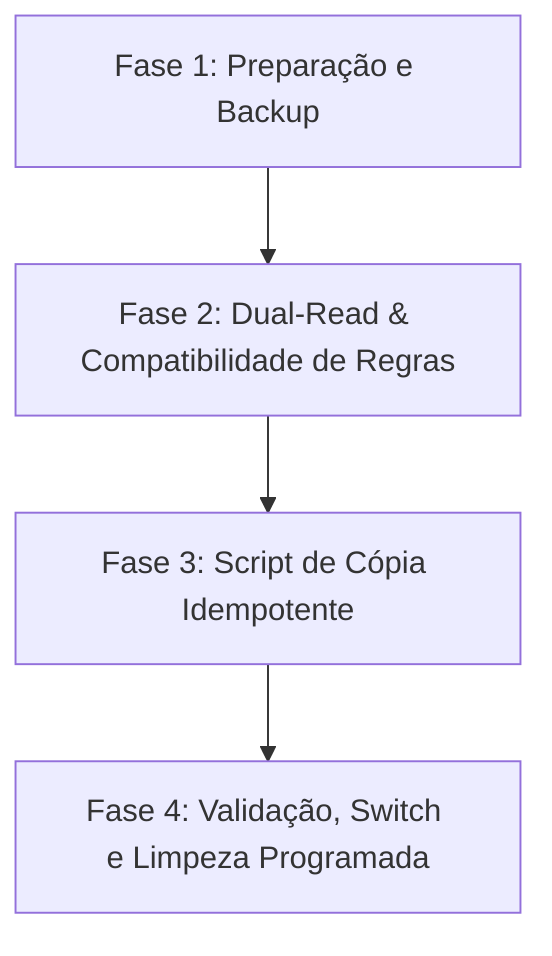

# PLANO DE MIGRAÇÃO FIRESTORE — IPLEX

**Projeto:** `iplex-2c8fc`  
**Status:** Planejado / Aguardando Autorização Explícita para Execução em Produção  
**Princípio Zero:** *Nenhum dado de produção será excluído ou alterado de forma destrutiva sem autorização prévia, backup completo e validação em ambiente de staging/emulador.*

---

## 1. Inventário da Estrutura Atual (Legada)

Na modelagem original do ecossistema iPlex, a maioria dos recursos residia em **subcoleções aninhadas** dentro do documento de cada família (`families/{familyId}/...`):

```text
/users/{uid}
/families/{familyId}
  ├── /members/{uid}
  ├── /profiles/{profileId}
  │     ├── /favorites/{contentId}
  │     └── /watch_progress/{contentId}
  ├── /devices/{deviceId}
  │     └── /commands/{commandId}
  ├── /sources/{sourceId}
  ├── /catalog/{catalogId}
  ├── /source_access/{accessId}
  └── /private/subscription
/source_secrets/{familyId}_{sourceId}
/link_tokens/{tokenHash}
```

### Limitações e Desafios da Estrutura Atual
1. **Consultas Cruzadas:** Subcoleções aninhadas dificultam consultas globais e queries agregadas sem `collectionGroup`.
2. **Crescimento de Catálogo:** Itens de catálogo em `/families/{fid}/catalog/{cid}` sobrecarregam leituras do Firestore, gerando custos desnecessários em comparação ao Cloud Storage.
3. **Assinatura e Leases:** Manter `leases` e `subscription` misturados na família gera contenção de escrita concorrente em transações Firestore.
4. **Vínculo Frágil de Membros:** O uso de um mapa `members` no documento da família impõe limite rígido de concorrência e restringe metadados de adesão.

---

## 2. Esquema de Destino e Mapeamento

A nova arquitetura unifica todos os domínios em **coleções de primeiro nível**, garantindo desacoplamento, segurança baseada em `familyId` e escalabilidade horizontal:

| Recurso Legado | Coleção de Destino | Identificador de Vínculo |
| :--- | :--- | :--- |
| `/users/{uid}` | `/users/{uid}` | `uid` (Auth) |
| `/families/{fid}` | `/families/{familyId}` | `familyId`, `adminUid` |
| `/families/{fid}/members/{uid}` | `/family_members/{membershipId}` | `familyId`, `userUid` |
| `/families/{fid}/profiles/{pid}` | `/profiles/{profileId}` | `familyId` |
| `/families/{fid}/devices/{did}` | `/devices/{deviceId}` | `familyId`, `deviceId` |
| `/families/{fid}/sources/{sid}` | `/iptv_sources/{sourceId}` | `familyId`, `catalogId` |
| Jobs em andamento / transientes | `/iptv_sync_jobs/{jobId}` | `familyId`, `sourceId` |
| `/families/{fid}/catalog/{cid}` | `/catalogs/{catalogId}` + Cloud Storage | `storagePath` |
| `/families/{fid}/private/subscription` | `/subscriptions/{subscriptionId}` | `familyId` |
| `families.leases` (array no documento) | `/playback_sessions/{sessionId}` | `familyId`, `profileId`, `deviceId` |
| `profiles/{pid}/favorites/{cid}` | `/profile_favorites/{favoriteId}` | `familyId`, `profileId`, `contentId` |
| `profiles/{pid}/watch_progress/{cid}` | `/profile_progress/{progressId}` | `familyId`, `profileId`, `contentId` |

---

## 3. Estratégia de Migração em Fases (Dual-Write / Dual-Read)

Para evitar interrupção de serviço tanto para o Gestor (Flutter) quanto para o TV Player (React/TypeScript), a transição ocorre em 4 fases bem definidas:



### Fase 1: Backup e Congelamento
1. **Export do Firestore:** Execução de snapshot gerenciado via Google Cloud:
   ```bash
   gcloud firestore export gs://iplex-2c8fc-firestore-backups/firestore-pre-migration-$(date +%Y%m%d) \
       --project=iplex-2c8fc
   ```
2. **Auditoria de Integridade:** Validação de ausência de documentos órfãos e fontes corrompidas antes do início.

### Fase 2: Dual-Read e Regras de Segurança Unificadas
1. **Deploy das Novas Regras:** O arquivo `firestore.rules` atualizado dá suporte tanto às coleções de primeiro nível quanto às subcoleções aninhadas legadas.
2. **Atualização do Repositório do Gestor:** `FirebaseManagerRepository` no Flutter já possui suporte resiliente para ler `displayName`/`name`, `adminUid`/`adminId` e `primaryFamilyId`/`familyId`.

### Fase 3: Execução do Script de Migração Idempotente
O script lê as subcoleções legadas e grava nas novas coleções de primeiro nível em lotes (`writeBatch` de até 500 operações), sem sobrescrever dados mais recentes caso o documento já exista.

### Fase 4: Validação, Comutação e Depreciação
1. Comprovação da leitura por todas as versões ativas do Gestor e TV Player.
2. Congelamento de escrita nas subcoleções legadas.
3. Desativação programada (com período de carência de 60 dias) das subcoleções antigas.

---

## 4. Script de Migração Idempotente (`migrate_to_top_level.ts`)

O script de migração a seguir foi projetado para execução administrativa via Firebase Admin SDK. Ele é 100% idempotente (pode ser executado múltiplas vezes com segurança):

```typescript
import * as admin from 'firebase-admin';

if (!admin.apps.length) {
  admin.initializeApp({ projectId: 'iplex-2c8fc' });
}
const db = admin.firestore();

export async function runMigration(dryRun: boolean = true) {
  console.log(`[iPlex Migration] Starting migration. DryRun: ${dryRun}`);

  const familiesSnap = await db.collection('families').get();
  console.log(`Found ${familiesSnap.size} families to migrate.`);

  let totalMembers = 0;
  let totalProfiles = 0;
  let totalDevices = 0;
  let totalSources = 0;
  let totalFavorites = 0;
  let totalProgress = 0;

  for (const familyDoc of familiesSnap.docs) {
    const familyId = familyDoc.id;
    const familyData = familyDoc.data();
    const adminUid = familyData.adminUid || familyData.adminId || '';

    // 1. Atualizar documento da família com adminUid padronizado
    if (!dryRun && !familyData.adminUid && adminUid) {
      await familyDoc.ref.update({
        adminUid,
        status: familyData.status || 'active',
        maxMembers: familyData.maxMembers || 5,
        updatedAt: admin.firestore.FieldValue.serverTimestamp(),
      });
    }

    // 2. Migrar members -> family_members
    const membersSnap = await familyDoc.ref.collection('members').get();
    for (const mDoc of membersSnap.docs) {
      const mData = mDoc.data();
      const userUid = mDoc.id;
      const membershipId = `${familyId}_${userUid}`;
      const targetRef = db.collection('family_members').doc(membershipId);

      const role = userUid === adminUid ? 'admin' : (mData.role || 'member');

      if (!dryRun) {
        await targetRef.set({
          familyId,
          userUid,
          role,
          status: 'active',
          joinedAt: mData.joinedAt || familyData.createdAt || admin.firestore.FieldValue.serverTimestamp(),
        }, { merge: true });
      }
      totalMembers++;
    }

    // 3. Migrar profiles -> profiles
    const profilesSnap = await familyDoc.ref.collection('profiles').get();
    for (const pDoc of profilesSnap.docs) {
      const pData = pDoc.data();
      const profileId = pDoc.id;
      const targetRef = db.collection('profiles').doc(profileId);

      if (!dryRun) {
        await targetRef.set({
          familyId,
          name: pData.name || 'Perfil',
          avatarKey: pData.avatarKey || 'avatar-01',
          status: 'active',
          createdByUid: pData.createdByUid || adminUid,
          createdAt: pData.createdAt || admin.firestore.FieldValue.serverTimestamp(),
          updatedAt: pData.updatedAt || admin.firestore.FieldValue.serverTimestamp(),
        }, { merge: true });
      }
      totalProfiles++;

      // 3.1 Migrar favorites do perfil
      const favSnap = await pDoc.ref.collection('favorites').get();
      for (const fDoc of favSnap.docs) {
        const fData = fDoc.data();
        const contentId = fDoc.id;
        const favId = `${profileId}_${contentId}`;
        const targetFavRef = db.collection('profile_favorites').doc(favId);

        if (!dryRun) {
          await targetFavRef.set({
            familyId,
            profileId,
            contentId,
            title: fData.title || '',
            catalogId: fData.catalogId || null,
            createdAt: fData.createdAt || admin.firestore.FieldValue.serverTimestamp(),
            updatedAt: fData.updatedAt || admin.firestore.FieldValue.serverTimestamp(),
          }, { merge: true });
        }
        totalFavorites++;
      }

      // 3.2 Migrar watch_progress do perfil
      const progSnap = await pDoc.ref.collection('watch_progress').get();
      for (const prDoc of progSnap.docs) {
        const prData = prDoc.data();
        const contentId = prDoc.id;
        const progId = `${profileId}_${contentId}`;
        const targetProgRef = db.collection('profile_progress').doc(progId);

        if (!dryRun) {
          await targetProgRef.set({
            familyId,
            profileId,
            contentId,
            position: prData.position || 0,
            duration: prData.duration || 0,
            updatedAt: prData.updatedAt || admin.firestore.FieldValue.serverTimestamp(),
          }, { merge: true });
        }
        totalProgress++;
      }
    }

    // 4. Migrar devices -> devices
    const devicesSnap = await familyDoc.ref.collection('devices').get();
    for (const dDoc of devicesSnap.docs) {
      const dData = dDoc.data();
      const deviceId = dDoc.id;
      const targetRef = db.collection('devices').doc(deviceId);

      if (!dryRun) {
        await targetRef.set({
          familyId,
          displayName: dData.name || dData.displayName || 'Smart TV',
          platform: dData.platform || 'android_tv',
          status: 'linked',
          lastSeenAt: dData.lastSeenAt ? admin.firestore.Timestamp.fromMillis(dData.lastSeenAt) : null,
          linkedAt: dData.createdAt ? admin.firestore.Timestamp.fromMillis(dData.createdAt) : admin.firestore.FieldValue.serverTimestamp(),
          linkedByUid: dData.linkedByUid || adminUid,
        }, { merge: true });
      }
      totalDevices++;
    }

    // 5. Migrar sources -> iptv_sources
    const sourcesSnap = await familyDoc.ref.collection('sources').get();
    for (const sDoc of sourcesSnap.docs) {
      const sData = sDoc.data();
      const sourceId = sDoc.id;
      const targetRef = db.collection('iptv_sources').doc(sourceId);

      const rawType = sData.type || sData.format || 'url';
      const normalizedType = rawType === 'other_m3u8' ? 'm3u8_alternative' : (rawType === 'm3u' ? 'url' : rawType);

      if (!dryRun) {
        await targetRef.set({
          familyId,
          name: sData.name || 'IPTV',
          type: normalizedType,
          status: sData.status || 'ready',
          catalogId: sData.catalogId || null,
          credentialsRef: `source_secrets/${familyId}_${sourceId}`,
          epgEnabled: !!sData.hasEpg,
          pinProtected: !!sData.isProtected,
          contentCount: sData.contentCount || 0,
          createdByUid: adminUid,
          updatedByUid: adminUid,
          createdAt: sData.createdAt ? admin.firestore.Timestamp.fromMillis(sData.createdAt) : admin.firestore.FieldValue.serverTimestamp(),
          updatedAt: sData.updatedAt ? admin.firestore.Timestamp.fromMillis(sData.updatedAt) : admin.firestore.FieldValue.serverTimestamp(),
          lastSyncAt: sData.lastAttemptAt ? admin.firestore.Timestamp.fromMillis(sData.lastAttemptAt) : null,
          errorCode: sData.errorCode || null,
        }, { merge: true });
      }
      totalSources++;
    }

    // 6. Migrar private/subscription -> subscriptions/{familyId}
    const subDoc = await familyDoc.ref.collection('private').doc('subscription').get();
    if (subDoc.exists) {
      const sData = subDoc.data()!;
      const subRef = db.collection('subscriptions').doc(familyId);
      if (!dryRun) {
        await subRef.set({
          familyId,
          status: sData.status === 'trial' ? 'trialing' : (sData.status || 'not_started'),
          plan: 'monthly',
          trialStartedAt: sData.trialStartedAt ? admin.firestore.Timestamp.fromMillis(sData.trialStartedAt) : null,
          trialEndsAt: sData.trialEndsAt ? admin.firestore.Timestamp.fromMillis(sData.trialEndsAt) : null,
          currentPeriodEndsAt: sData.paidUntil ? admin.firestore.Timestamp.fromMillis(sData.paidUntil) : null,
          updatedAt: admin.firestore.FieldValue.serverTimestamp(),
        }, { merge: true });
      }
    }
  }

  console.log(`[iPlex Migration Complete] Summary:
    - Members: ${totalMembers}
    - Profiles: ${totalProfiles}
    - Devices: ${totalDevices}
    - Sources: ${totalSources}
    - Favorites: ${totalFavorites}
    - Progress entries: ${totalProgress}`);
}
```

---

## 5. Plano de Rollback e Contingência

Em caso de qualquer anomalia constatada durante a migração:
1. **Rollback Imediato:** As leituras e escritas das aplicações legadas continuam funcionando normalmente contra as subcoleções `/families/{fid}/...`, que **não são deletadas**.
2. **Restauração de Backup:** Caso ocorra corrupção de dados:
   ```bash
   gcloud firestore import gs://iplex-2c8fc-firestore-backups/firestore-pre-migration-YYYYMMDD \
       --project=iplex-2c8fc
   ```
3. **Isolamento de Erros:** O script utiliza `dryRun: true` por padrão para validação prévia de 100% dos registros antes de qualquer persistência física.
