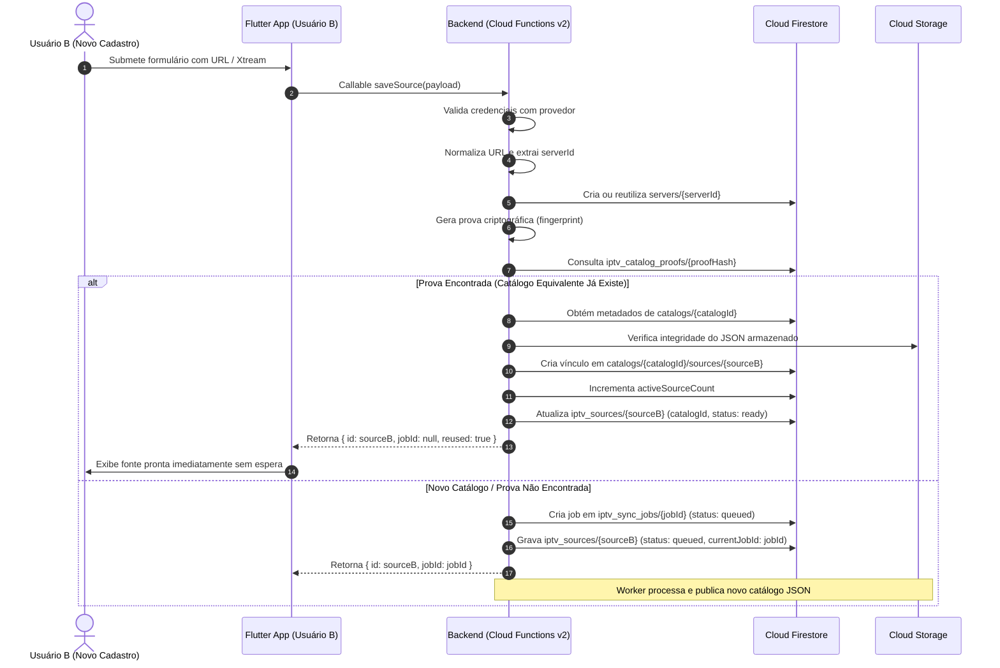
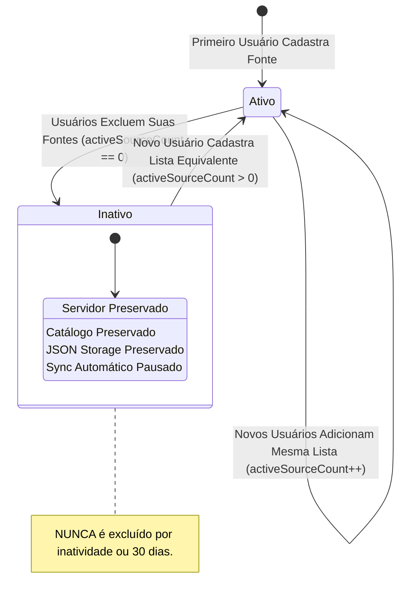

# FLUXO DE SINCRONIZAÇÃO IPTV — IPLEX

**Projeto:** iPlex  
**Firebase:** `iplex-2c8fc`  
**Escopo:** Ciclo de vida completo das sincronizações manual e automática diária, reutilização de catálogos e notificações.

---

## 1. DIAGRAMA DE SEQUÊNCIA: CADASTRO COM REUTILIZAÇÃO INTELIGENTE

---

## 2. ETAPAS DO JOB DE SINCRONIZAÇÃO (`stage` e `progress`)

Durante o processamento assíncrono de uma nova versão de catálogo, o worker atualiza as seguintes etapas atômicas:

| Etapa (`stage`) | Progresso (`progress`) | Descrição |
|:---|:---:|:---|
| `queued` | `0` | Enfileirado no Firestore, aguardando slot de execução. |
| `identifying_server` | `5` | Normalização de endpoint e registro/reuso em `servers/{serverId}`. |
| `validating_source` | `10` | Validação de credenciais e proteção SSRF contra loopback/redes privadas. |
| `downloading` | `null` (Indeterminado) | Download via streaming. A barra global exibe animação contínua sem números fictícios. |
| `parsing` | `30` | Normalização estrutural de canais ao vivo, filmes VOD e séries com temporadas/episódios. |
| `uploading_catalog` | `85` | Upload do JSON consolidado para Cloud Storage (`catalogs/{version}.json`). |
| `publishing_catalog` | `95` | Gravação atômica em `catalogs/{version}`, atualização de `activeSourceCount` e vinculação de fontes. |
| `completed` | `100` | Promoção definitiva, finalização dos jobs e despacho de notificações. |
| `failed` | `null` | Falha terminal com captura de `errorCode`. O catálogo anterior permanece preservado intacto. |

---

## 3. SINCRONIZAÇÃO AUTOMÁTICA DIÁRIA À MEIA-NOITE DE BRASÍLIA

### 3.1 Agendamento Global
- Disparo configurado via Cloud Scheduler:
  `schedule: '0 0 * * *'`, `timeZone: 'America/Sao_Paulo'`.
- Não depende do fuso do dispositivo móvel nem do servidor IPTV.

### 3.2 Execução Otimizada por Catálogo
Diariamente, às 00:00 BRT:
1. **Identificação de Catálogos:** O worker lê os catálogos existentes na coleção `catalogs`.
2. **Filtro de Ativos:** Catálogos com `activeSourceCount <= 0` são sumariamente ignorados. Nenhuma requisição é feita ao provedor para listas sem usuários ativos.
3. **Agrupamento de Tarefas:** Para cada catálogo com fontes ativas:
   - Seleciona uma fonte habilitada e autorizada para realizar a checagem.
   - Gera um único job de sincronização para aquele catálogo.
   - Mesmo que 10 ou 100 usuários utilizem o mesmo catálogo, **apenas 1 download e 1 parsing são executados**.
4. **Publicação e Atualização Coletiva:**
   - O novo JSON é gerado e promovido no Cloud Storage.
   - Todas as fontes ativas vinculadas àquele catálogo são atualizadas com a nova versão publicada e novo `lastSuccessfulSyncAt`.
   - Nenhuma notificação push massiva ou intrusiva é gerada para sincronizações de rotina bem-sucedidas.

---

## 4. SINCRONIZAÇÃO MANUAL POR FONTE

1. O usuário abre a página de detalhes da IPTV e toca em "Sincronizar".
2. O aplicativo chama `syncSource({ id: sourceId })`.
3. O backend verifica autorização da família e do PIN.
4. **Inteligência de Concorrência:**
   - Se o catálogo dessa fonte já estiver em sincronização ativa (por exemplo, iniciado pela rotina diária ou por outra fonte equivalente), o backend vincula a requisição do usuário a esse fluxo, reportando o progresso sem duplicar requisições contra o provedor.
   - Se nenhuma sincronização estiver em andamento, enfileira o job individual.
5. **Barra Global de Progresso:** Ativada no app móvel, posicionada entre a Status Bar e a AppBar.
6. **Notificação Exclusiva:** Ao concluir, apenas o usuário que solicitou a sincronização manual recebe o Bottom Sheet (em foreground) ou Push Notification (em background).

---

## 5. REGRAS DE RETENÇÃO INDEFINIDA E REATIVAÇÃO

1. **Permanência:** Catálogos com zero fontes ativas permanecem intactos indefinidamente no Firestore e Cloud Storage.
2. **Reativação Segura:** Quando um novo usuário adiciona credenciais correspondentes a um catálogo inativo:
   - Suas credenciais são validadas contra o provedor.
   - O catálogo inativo é reativado (`activeSourceCount = 1`).
   - O JSON anterior é mantido acessível para exibição imediata.
   - Um job de sincronização é enfileirado para atualizar o catálogo para a versão mais recente.
